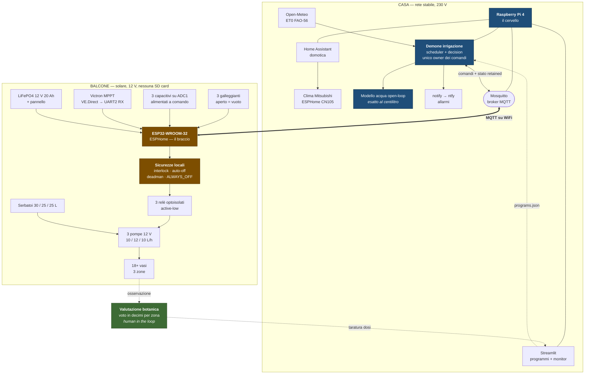

# Architettura target — Pi 4 a domotica, nodo ESP32 in campo

Stato: **progettata il 2026-07-26**, non implementata. Decisione presa quando è emersa
l'esigenza di usare il Pi 4 come cervello di domotica (clima Mitsubishi e altro),
liberandolo dal ruolo di controller d'irrigazione.

Documento di riferimento per la Fase 6 in poi. Sostituisce le scelte hardware di
[upgrade-sensori.md](upgrade-sensori.md) §Fase 6 (ADS1115 e cavo VE.Direct-USB), **non**
il ragionamento agronomico, che resta valido tale e quale.

---

## L'idea in una riga

**Il Pi decide, il nodo protegge.** Tutta l'intelligenza (schedule, modello dell'acqua,
ET0, UI, notifiche) resta in Python sul Pi 4 in casa; sul balcone va un ESP32 che è
braccio e non cervello, ma con abbastanza autonomia da non fare danni se il cervello
sparisce.

## Mappa concettuale

## Chi possiede cosa

| Responsabilità | Dove vive | Perché lì |
|---|---|---|
| Quando e quanto irrigare | Pi 4 | modello acqua validato, 140 test, ET0 |
| Precisione dei tempi di corsa | Pi 4 | il modello è esatto al centilitro, non si tocca |
| **Non fare danni** | ESP32 | deve valere anche se WiFi o Pi spariscono |
| Mutua esclusione fra pompe | **entrambi** | oggi è solo un lock Python; va replicata come interlock sul nodo |
| Stato per la UI | cache locale su MQTT retained | `snapshot()` non deve fare round-trip di rete a ogni rerun Streamlit |

## Le quattro sicurezze del nodo

Sono config dichiarativa ESPHome, non C scritto a mano:

1. **interlock** — mai due pompe insieme, replica hardware di `allow_multiple: false`
2. **auto-off** — spegnimento forzato oltre la corsa massima attesa (largo: ~25 min su 19)
3. **deadman — 30 s** senza keepalive con pompa attiva → tutto off
4. **`restore_mode: ALWAYS_OFF`** — al boot le pompe sono spente, sempre

Il caso che queste proteggono è concreto: `pulse()` fa `on()` → `sleep` → `off()` dal lato
Pi. Senza il deadman, un WiFi che cade a metà di una corsa da 19 minuti svuota il serbatoio.

### Perché il deadman a 30 s e non a 5

Con RSSI −73 dBm (misurato il 2026-07-26 nel punto del Pi) i micro-buchi di rete sono
fisiologici. Un deadman corto li trasforma tutti in **irrigazioni troncate**: dose corta,
nessun errore visibile, e il modello open-loop inizia a mentire in silenzio — il fallimento
peggiore possibile per questo sistema. Il costo del deadman largo si calcola:

- pompa più veloce = 12 L/h = 3,33 mL/s
- peggior caso, il Pi muore e la pompa continua per la finestra intera → **100 mL**
- su una dose P1 da 3,17 L/gg è il 3 %, una tantum

Cento millilitri di rischio contro l'immunità ai buchi di rete. L'auto-off a ~25 min resta
il paracadute sul caso catastrofico (svuotamento serbatoio), che è ciò che conta davvero.

## Impatto sul codice: tre seam, nient'altro

`MockOutput` ([pump_controller.py:69](../software/pump_controller.py:69)) definisce già il
protocollo duck-typed (`on/off/is_active/close/closed`). Il backend remoto lo soddisfa e
daemon, scheduler e decision non se ne accorgono.

| Seam | File | Sostituzione |
|---|---|---|
| `_build_output` | [pump_controller.py:182](../software/pump_controller.py:182) | `RemoteOutput` — comando MQTT + stato in cache |
| `_build_input` | [sensors.py:170](../software/sensors.py:170) | `RemoteFloat` — stessa semantica pull-up |
| `self._adc` | [sensors.py:271](../software/sensors.py:271) | `RemoteAdc.read_single(addr, channel)` — firma invariata, `addr` = id nodo |

Il backend remoto si **aggiunge** accanto a `resolve_mock_mode`, non lo sostituisce: i 140
test restano validi, ne servono di nuovi solo per il client MQTT.

Effetto collaterale utile: `resolve_mock_mode` auto-mocka fuori da Linux, ma col backend
remoto si sviluppa **da Windows contro l'hardware vero**.

## Scheda scelta: ESP32-DevKitC-32UE, 38 pin

Modulo **WROOM-32UE**: la `U` nella sigla significa connettore IPEX per antenna esterna.
Deciso dalla misura RSSI, vedi sotto. Piattaforma più battuta di ESPHome, migliaia di
installazioni identiche: su un sistema che deve spegnere una pompa da solo, "noioso e
collaudato" vale più di Wi-Fi 6.

Prendere la versione a **38 pin**: alcune varianti corte tagliano proprio i GPIO 32-34.

### Perché antenna esterna

RSSI **−73 dBm** misurato col telefono nel punto del Pi. Non è drammatico di per sé — il Pi
lì funziona da settimane — ma:

- la misura è col **telefono**, che ha antenne migliori di una traccia su PCB;
- il nodo va **dentro una scatola** con relè e buck: 3-10 dB di attenuazione.

Stima realistica per un ESP32 con antenna PCB in quel punto: −80/−85 dBm, cioè la soglia
dove iniziano ritrasmissioni e disconnessioni. Con antenna esterna montata **fuori dal
contenitore** si recuperano 10-15 dB. Differenza di costo: ~2 € sulla scheda più il pigtail.

### Piano pin

| Funzione | GPIO | Perché proprio questi |
|---|---:|---|
| Umidità ×3 | **32, 33, 34** | ADC1, l'unico utilizzabile con WiFi attivo |
| Galleggianti ×3 | **25, 26, 27** | hanno il pull-up interno |
| Relè ×3 | **18, 19, 23** | nessuno strapping, nessun glitch al boot |
| VE.Direct RX | **16** | RX di UART2, di default |
| MOSFET sensori | **22** | alimentazione capacitivi a comando |

Evitati di proposito: GPIO 0, 2, 5, 12, 15 (strapping — al livello sbagliato all'accensione
la scheda non parte o entra in flash mode), GPIO 1 e 3 (console seriale), GPIO 36 e 39
(ADC1 ma con note di errata sulle letture, e non servono).

### Due trappole da non sbagliare

**I galleggianti NON possono stare su GPIO 34-39.** Sono solo-ingresso e **senza pull-up
interno**. Il contratto elettrico di [sensors.py](../software/sensors.py) — contatto chiuso
verso GND = acqua presente, filo rotto = vuoto — si regge tutto sul pull-up: su un pin senza,
si legge rumore e **il fail-safe si rovescia in silenzio**. Da qui la scelta di 25/26/27.

**I relè active-low vanno tenuti spenti prima che parta il firmware.** Fra alimentazione e
boot i GPIO flottano: su scheda active-low significa possibile chiusura momentanea, cioè
pompe che partono da sole all'accensione. `restore_mode: ALWAYS_OFF` copre il dopo-boot, non
quella finestra. Rimedio hardware: **tre pull-up da 10 kΩ a 3,3 V** sulle linee 18/19/23.

### Alimentazione

5 V dal buck sul pin **VIN**, mai sul 3V3 (bypasserebbe il regolatore). Lato optoisolatore
della scheda relè dal 3V3 della devkit come oggi dal Pi; **JD-VCC resta sul secondo buck**:
la separazione bobine/logica esistente non si tocca, è la ragione per cui l'impianto attuale
funziona.

## Cosa cambia nella lista della spesa

| Voce | Prima (Fase 6) | Dopo | Δ |
|---|---|---|---|
| ADS1115 su I2C | ~3 € | non serve, ADC1 integrato | −3 € |
| Cavo VE.Direct **USB** | ~30 € | cavo nudo / pigtail JST-PH 2 mm | −20 € |
| ESP32-DevKitC-32UE 38 pin | — | ~8 € | +8 € |
| Antenna 2,4 GHz + pigtail IPEX→SMA | — | ~3 € | +3 € |
| MOSFET per sensori | — | ~1 € | +1 € |
| 3 resistenze 10 kΩ (pull-up relè) | — | ~0,3 € | +0,3 € |
| Galleggianti ×3, capacitivi ×3 | invariati | invariati | — |

Il pulsante di shutdown su GPIO26 **sparisce**: senza filesystem non c'è niente da smontare.

## Vincoli elettrici da non scoprire dopo

- **ADC2 inutilizzabile con WiFi attivo** sull'ESP32 classico → i tre capacitivi vanno su
  ADC1 (GPIO32-39). Per questo WROOM-32 e non C3 supermini: 3 pompe + 3 galleggianti +
  3 umidità + 1 RX VE.Direct = 10 I/O.
- **Livello logico VE.Direct da misurare col tester** prima di collegarlo. Porta non
  isolata, livelli variabili per modello, su alcuni il TX idla vicino ai 5 V. Partitore da
  due resistenze se non sei a 3,3 V. Massa comune non è un problema: stesso 12 V.
- **Sensori capacitivi alimentati da GPIO via MOSFET**, energizzati solo durante la
  lettura: evita l'elettrolisi che se li mangia in un paio di stagioni.
- ⚠ **Il rail 5 V ha già ucciso un Pi Zero 2 W** su questo impianto (vedi
  [README](../README.md), revisione doppio buck). Il nodo va sullo stesso rail: prima di
  dargli tensione, multimetro, come da [checklist-accensione.md](checklist-accensione.md).

## Bilancio energetico

| | Assorbimento | Consumo/gg |
|---|---:|---:|
| Pi 4 (oggi, sul balcone) | ~2,7-3,5 W | ~70 Wh |
| ESP32 WiFi sempre attivo | ~0,4 W | ~10 Wh |

Su 240 Wh di batteria il margine diventa enorme, e il Pi 4 passa a rete in casa.
**Niente deep sleep**: guadagno trascurabile, e perderesti il comando manuale dalla UI.

## Migrazione senza fermare l'impianto

Il sistema non si è mai interrotto dal 2026-07-07. Quindi in due passi, non uno:

1. nodo montato al banco, Pi in mock, verifica del backend remoto e dei test nuovi;
2. swap fisico **in una finestra fra due irrigazioni**, lasciando il Pi 4 sul balcone
   finché il nodo non ha fatto qualche ciclo reale.

Da verificare **prima di comprare**: che il WiFi copra il balcone con margine. Oggi il Pi
ci arriva, ma l'antenna di un devkit ESP32 è un'altra cosa.

## Cosa resta valido di Fase 5

Tutto il software del branch `feature/sensori`. In particolare `notify` (ntfy) va anticipato
a prescindere dal nodo: è l'unica parte che dà valore senza sensori, gira meglio sul Pi in
casa con rete stabile, e avrebbe segnalato il serbatoio vuoto di pompa_1 del 18/07.

Col nodo acquista un allarme in più: **notifica sulla disconnessione del nodo**. Con un link
a −73 dBm il degrado va saputo prima che diventi un problema di piante, non dopo. Lato
ESPHome, `fast_connect: true` sull'unico AP.

## Alternative scartate

| Opzione | Costo | Perché no |
|---|---:|---|
| Orange Pi Zero 3, codice invariato | ~20 € | resta SD card su solare, consumo alto, GPIO da rimappare e `LGPIOFactory` da forzare |
| Luckfox Pico / Milk-V Duo | ~8-10 € | 64-256 MB di RAM, Streamlit non ci gira: costo di Linux senza i vantaggi |
| ESP32 standalone, logica riscritta | ~5 € | butta via il modello dell'acqua validato e i 140 test |
