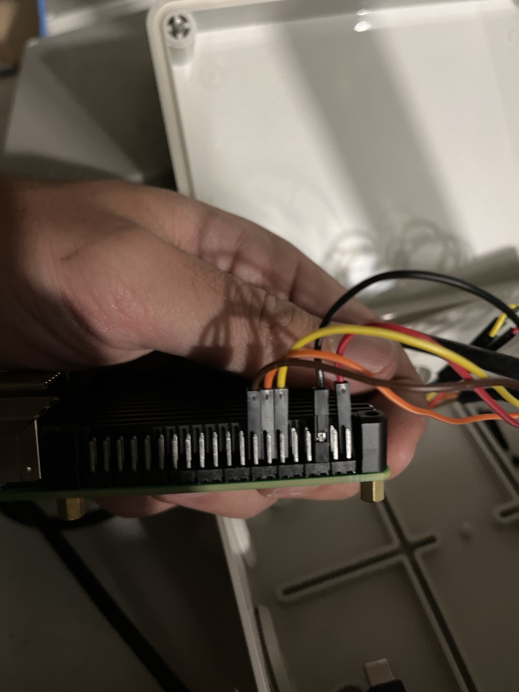

# Incidente blackout di ottobre 2026 e fermo invernale

> Resoconto del 14/10/2026. Stato attuale: **impianto fermo per l'inverno**, ripartenza
> prevista dal 10/04/2027. Torna a [stato-deploy.md](stato-deploy.md).

## In breve

- **7–10/10**: quattro giorni quasi senza sole, la batteria si esaurisce e il BMS la stacca.
- **11/10**: un taglio di corrente durante l'avvio azzera i file di rete, e da lì il Pi non trova più il Wi-Fi.
- **11–14/10**: il net-watchdog riavvia il Pi ogni 15 minuti, per circa 300 riavvii. Il demone
  continua a irrigare, ma con l'orologio sbagliato.
- **14/10**: SD letta e riparata dal NucBox, Wi-Fi ripristinato e verificato. Poi l'impianto
  viene fermato per l'inverno.

## Causa 1 — bilancio energetico in deficit

Dati dall'export SolarHistory di VictronConnect, in [dati/solarhistory-2026-10-14.csv](dati/solarhistory-2026-10-14.csv):

| periodo | picco PV | resa | min batteria (notte) | absorption/float |
|---|---|---|---|---|
| luglio | 56–72 W | — | 13,1–13,2 V | ogni giorno |
| 14/09–06/10 | 9–17 W | 50–70 Wh/gg | da 13,18 a 12,92 V | **0 min** per tutti i 30 giorni |
| 07–09/10 | 12–15 W | 10–30 Wh/gg | 12,88 → 12,76 → 12,46 V | 0 |
| 10–14/10 | 9–14 W | 10–60 Wh/gg | **0,00 V** (BMS in protezione) il 10, 11 e 13/10 | 0 |

Il Pi 4 consuma circa 70 Wh al giorno. Da metà settembre il pannello, probabilmente in ombra
con il sole basso, rendeva al massimo quanto il consumo, e la batteria non è mai più arrivata
a carica piena. Quattro giorni bui (4–6 MJ/m², 75 mm di pioggia l'8–9/10) l'hanno svuotata.
Quando la batteria è vicina allo zero, ogni avvio di una pompa fa crollare la tensione e
resetta il Pi.

## Causa 2 — configurazione di rete azzerata

Su Raspberry Pi OS Trixie NetworkManager salva le connessioni in netplan
(`/etc/netplan/90-NM-<uuid>.yaml`) e **le riscrive a ogni avvio**. L'11/10 la corrente è
mancata proprio durante quella riscrittura, ed entrambi i file (Wi-Fi ed Ethernet) sono rimasti
a **0 byte**. Senza un profilo Wi-Fi:

- il net-watchdog fallisce i controlli a 0, 5, 10 e 15 minuti e riavvia il Pi, ogni 15 minuti
  esatti (si vede in `cloud-init.log`: 78 + 92 + 96 + 45 avvii);
- un riavvio non può riparare una configurazione persa, quindi il ciclo non si interrompe mai da solo.

## Effetti collaterali

- **Orologio**: il Pi non ha RTC. Senza NTP, a ogni avvio riparte dall'ultimo orario salvato.
  Dall'11/10 i turni sono partiti a orari reali sbagliati: al ripristino, alle 19:22, il Pi
  credeva che fossero le 11:28.
- **Turni interrotti**: in `events.jsonl` ci sono `programma_on` senza `run_off` l'11, il 12 e
  il 13/10, quando l'avvio della pompa con la batteria scarica resettava il Pi. Le stime d'acqua
  della UI non sono affidabili.
- **File system**: solo errori di conteggio e di bitmap. Nessun file danneggiato oltre ai due di rete.
- **LED verde a "10 lampi"**: è il lampeggio di spegnimento di ogni riavvio, non un blocco.
- **Journal di sistema non persistente** (`/var/log/journal` vuota). La diagnosi si è basata su
  `boot.log`, `cloud-init.log`, `events.jsonl`, `pi-temp.csv` e sui `state.json.*.tmp` orfani:
  ognuno corrisponde a un taglio di corrente durante una scrittura.

## Riparazione (14/10)

1. **Lettura della SD dal NucBox.** `wsl --mount` non supporta i lettori USB (errore
   `0x8007000f`), quindi si usa usbipd-win: `usbipd bind --busid <id>` da amministratore, poi
   `usbipd attach --wsl --busid <id>` con una distro WSL (Debian) accesa.
2. **Backup** con la partizione montata `ro,noload`, in `Documents\irrigatore-logs\20261014-sd\`
   sul NucBox. Il backup resta fuori dal repo perché contiene segreti.
3. **`e2fsck -fy`** sulla partizione, seguito da una verifica `-fn` pulita.
4. **Rete.** File vuoti spostati in `/var/backups/netplan-vuoti-20261014/`;
   `/etc/netplan/50-cloud-init.yaml` ripristinato copiando `bootfs/network-config`, che
   Raspberry Pi Imager aveva scritto all'installazione. Al primo avvio NetworkManager lo
   riconverte in `90-NM-*.yaml`.
5. **Verifica**: Wi-Fi, Tailscale, NTP e servizi OK, `throttled=0x0`.

## Stato invernale (dal 14/10/2026)

- **Pi** spento con `poweroff` pulito e portato in casa. `irrigatore-daemon` è **disabilitato**
  e non parte all'avvio; `irrigatore-web` e `net-watchdog` restano abilitati.
- **Config viva** al 03/10 (regime autunnale) riportata in `software/programs.json`:
  P1 23:00×600 s (portata 15 L/h), P2 22:30×300 s, P3 22:00×500 s. Le sezioni della Fase 5
  restano invariate.
- **Batteria**: lasciata caricare dal pannello, poi scollegata (prima il pannello, poi la
  batteria) e messa in casa. Una LiFePO4 non va caricata sotto 0 °C.
- **Cablaggio GPIO** staccato, foto qui sotto. Nella foto l'estremità del pin 1 è a destra, vicino
  al distanziale.

| filo | pin | segnale | verso |
|---|---|---|---|
| rosso | 1 | 3,3 V | VCC della scheda relè (lato opto) — **non il pin 2 (5 V), che è accanto** |
| nero | 6 | GND | GND comune |
| giallo | 11 | GPIO17 | IN1 — pompa_1 |
| arancio | 13 | GPIO27 | IN2 — pompa_2 |
| marrone | 15 | GPIO22 | IN3 — pompa_3 |

## Ripartenza in primavera — checklist

1. **Architettura.** Preferita: Pi in casa sulla rete elettrica e nodo ESP32 in campo
   (vedi [architettura-nodo-esp32.md](architettura-nodo-esp32.md)), che sul balcone consuma
   circa 10 Wh al giorno e regge anche l'inverno. Alternativa: pannello più grande o spostato.
2. **Se il Pi torna sui relè**: ricablare come nella tabella sopra (rosso sul pin 1!), seguire la
   [checklist-accensione.md](checklist-accensione.md) sezione D, poi
   `sudo systemctl enable --now irrigatore-daemon`.
3. **Correzioni emerse da questo incidente:**
   - watchdog hardware (`dtparam=watchdog=on` e `RuntimeWatchdogSec` in systemd);
   - journal persistente (`Storage=persistent`);
   - controllo all'avvio, prima di NetworkManager: se un `/etc/netplan/*.yaml` è vuoto, ripristino da `bootfs/network-config`;
   - niente turni con l'orologio non sincronizzato (`NTPSynchronized=no` dopo un avvio senza rete), oppure un RTC;
   - notifiche ntfy (Fase 5): avrebbero segnalato il problema già l'11/10;
   - niente avvio delle pompe con la batteria sotto soglia (`power.py`, Fase 5).
4. **Rabbocco** delle taniche e reset dei livelli dalla UI.
